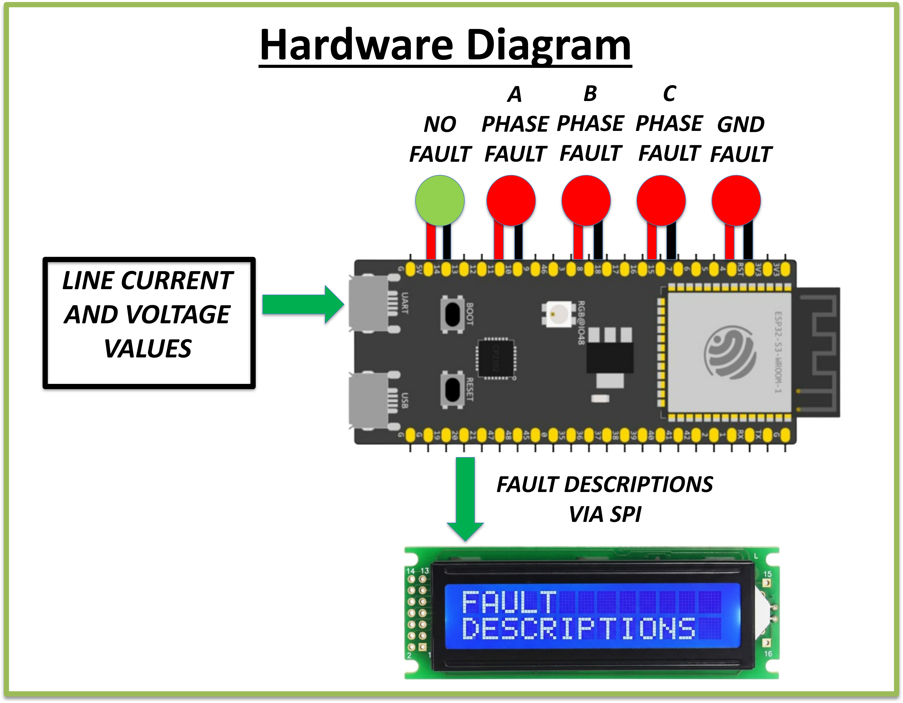
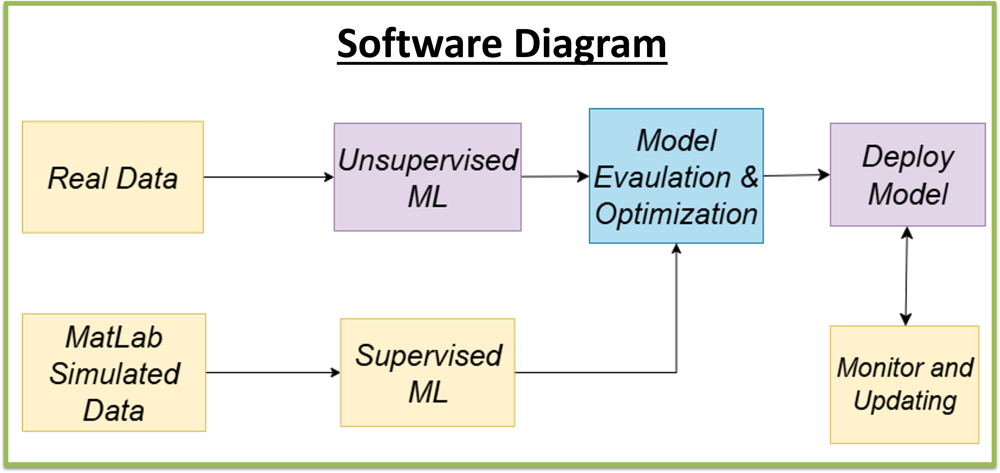

# Fault Detection Fall 2026

Fault detection analysis and modeling workspace for transmission-line event data. This system uses machine learning to detect faults in a transmission lines utilizing a ESP32-s3.

## System Overview

## Repository Layout

- `notebooks/` - analysis and model-development notebooks.
- `data/processed/` - processed CSV datasets used by the notebooks.
- `models/` - saved model weights used by the project.
- `figures/` - exported plots and visual results.
- `hardware/` - microcontroller firmware, schematics, wiring notes, datasheets, and hardware test logs.

## Data Policy

## Notes

Run notebooks from the `notebooks/` directory or keep their relative paths unchanged. The notebooks reference processed data through `../data/processed/` and saved models through `../models/`.

Hardware documentation starts in `hardware/README.md`. The repo is prepared for an ESP-IDF firmware project under `hardware/firmware/esp-idf/`.
